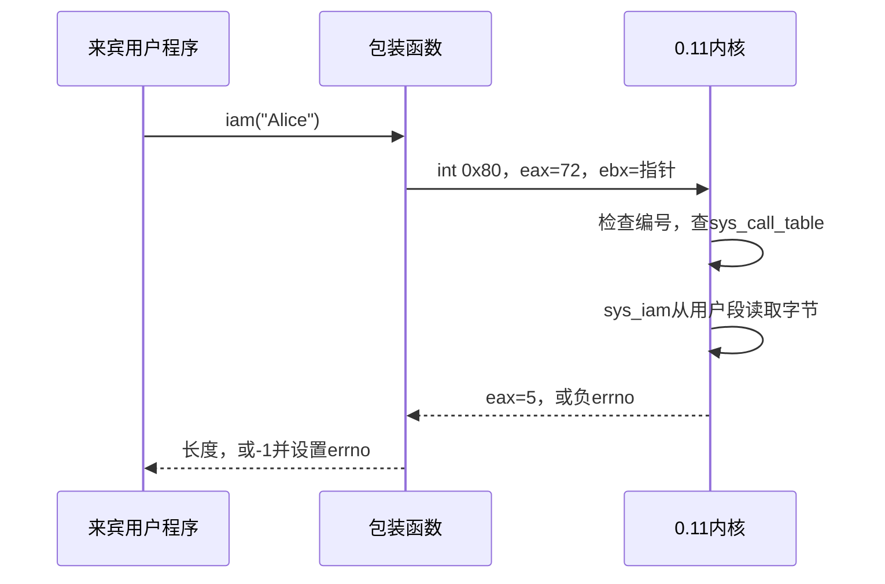

# 实验一：让用户程序调用自己的内核函数

> 完整仓库包含独立参考实现；学生发布包不含 `reference/`。学生包中跳过参考演示，完成代码后使用默认的 `make check-lab1` 验收自己的实现。

本实验运行在 **QEMU里的真实 Linux 0.11**。Ubuntu/WSL2负责编辑和编译，来宾负责执行新增系统调用。你已经会写C函数；本实验要理解：为什么用户程序不能像普通函数一样直接调用内核函数，参数如何跨过这道边界。

## 1. 目标与准备

完成两个系统调用：`iam`保存一个姓名，`whoami`把姓名复制回调用者。两者共享内核中的一份姓名，因此先运行`iam`再启动另一个`whoami`程序仍能读到姓名；重启后清空。没有按用户隔离，也不是生产系统的身份认证。

先完成[环境配置](setup-wsl2.md)，然后在**仓库根目录、Ubuntu终端**运行：

```bash
make doctor
make prepare
make lab1
make check-lab1
```

默认是学生版本。初始代码能构建，但返回`ENOSYS`，所以自检失败是正常的待完成状态。用下面的命令观察参考结果：

```bash
make check-lab1 IMPL=reference
make run-lab1 IMPL=reference
```

没有WSLg窗口时，交互入口可加`QEMU_DISPLAY=curses`；自动检查本来就无需图形窗口。依赖由环境指导中的`apt`命令安装，不要另装旧GCC或把宿主程序复制到来宾执行。

## 2. 先理解调用路径



`int 0x80`是受控进入内核的入口。编号72/73属于**本实验的0.11内核**，不是你电脑上Ubuntu内核的相同编号。提供的`guest/lab01_api.h`已写好包装汇编，你需要能指出编号、参数寄存器和返回值，不需要自行设计汇编程序。

用户指针是当前进程数据段中的偏移。`get_fs_byte`通过FS访问用户数据；直接`*name`会使用内核段，含义不同。写入前用`verify_area`处理写保护和写时复制，再用`put_fs_byte`写回。`get_limit(0x17)`提供用户数据段的大小；用`length > limit - address`检查范围，避免`address + length`整数回绕。

这里的检查遵循0.11内存模型；它不具备现代`copy_from_user`完整的异常恢复能力，不能据此声称任意坏地址都与现代Linux完全一样。

## 3. 接口约定与手工例子

| 调用 | 成功 | 失败 |
| --- | --- | --- |
| `iam(const char *name)` | 保存0..23字节姓名，返回不含NUL的长度 | 超长`EINVAL`；NULL/越段`EFAULT` |
| `whoami(char *out, unsigned size)` | 复制字符串及NUL，返回不含NUL长度 | 容量不够`EINVAL`；NULL/越段`EFAULT` |

内核返回负errno；用户包装器返回`-1`并设置`errno`。`size`**包含末尾NUL**。`iam("Alice")`返回5，随后`whoami(out,6)`成功，`whoami(out,5)`失败。23字节姓名需要24字节输出空间。空姓名合法，输出仍需要1字节。

`iam`必须先读入临时数组、确定有效后再整体提交。若已有`Alice`，再传入24字节姓名，应当失败且原值仍是`Alice`。不足容量的输出也应保持原缓冲区不变。

## 4. 完成学生实现

源文件和补丁位于`labs/lab01/student/`；补丁已注册两个系统调用，`kernel/who.c`中两个函数留给你完成。

1. 阅读`kernel.patch`：系统调用表追加两项、汇编入口总数从72改为74、内核Makefile加入`who.o`。解释为何三处缺一不可。
2. 在学生`who.c`定义24字节保存区和长度。完成`sys_iam`，逐字节检查段界限、寻找NUL，保证失败不修改保存值。
3. 完成`sys_whoami`。按顺序验证指针、容量和实际写入范围，调用`verify_area`后逐字节写回。
4. 运行`make check-lab1`，查看`build/lab01/student/result-15.txt`。修复所有`FAIL`，直到出现`LAB01 PASS`且程序退出码为0。
5. 交互运行`make run-lab1`，在**Linux 0.11来宾shell**执行：

```sh
/lab/iam Alice
/lab/whoami
/lab/lab01_test
sync
```

第一条显示`saved 5 bytes`，第二条显示`Alice`。不要在Ubuntu终端执行这些路径。完整测试最后会把姓名改为空字符串；若要继续演示，请再次运行`iam`。

公共构建层把内核副本放在`build/lab01/student/kernel`，来宾磁盘放在同层`rootfs.img`。参考实现使用独立`build/lab01/reference/`。建议编辑学生overlay中的`who.c`；若在工作副本调试调用表或Makefile，提交前把修改整理回学生`kernel.patch`，新增文件整理回overlay。已有工作区不会重新应用修改后的patch；保留工作源码后换一个新工作区或请教师协助重建，切勿直接删除自己唯一的代码。

## 5. 自检、排错与提交

公共`lab01_test`包含普通往返、23/24字节边界、失败保留原值、容量0/23/24、NULL、越段和空姓名。可以补充测试，但不要修改测试来绕过失败。你还应展示两个独立用户程序共享内核数据。

- `ENOSYS`：仍在运行学生骨架，或启动了另一个实验的内核/磁盘。
- 内核链接提示找不到`sys_iam`：检查对象文件和系统调用表声明。
- 第一次成功、第二次读乱码：检查字符串NUL、FS访问和跨程序共享保存区。
- 来宾提示不能执行文件：使用套件的a.out来宾编译器，不要链接宿主glibc。独立编译方式为`python3 tools/guest_build.py labs/lab01/guest/lab01_test.c /tmp/lab01_test`；部署由`make lab1`完成。

提交学生patch及overlay源码、测试输出、来宾交互截图、关键检查的解释和实验报告。评分共100分：调用注册与路径解释20、iam实现25、whoami实现25、边界测试及证据20、报告与思考题10。

保留原材料的思考题：

1. 从0.11当前入口和提供的包装器看，可直接传递几个参数？如何通过指向结构体的指针扩展参数数量？说明指针验证的责任。
2. 用自己的话描述添加`foo()`系统调用的完整步骤。
3. 为什么长度23的姓名需要大小24的输出数组？为什么应当先检查、后提交？

原文以云课为环境，本套件改用固定本地基线和独立镜像，保留系统调用目标，增加边界验收；具体集成清单见[实验目录说明](../labs/lab01/README.md)。
